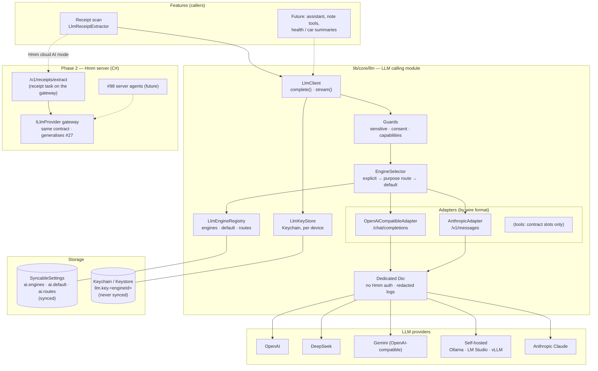

# LLM calling module — design

Status: draft for owner review · Tracker #97 · Branch `feat/llm-calling`
Builds on: ADR `docs/adr/0001-local-first-clients-thin-sync-server.md`,
#27 AI engine switch (server), #14 receipt scan, #26 sensitive exclusion,
#49 login-free tiers.

## 1. Intent

One module that every Hmm feature uses to talk to a large language model,
whichever provider the person chose: OpenAI, Claude, DeepSeek, Gemini, or a
self-hosted model (Ollama, LM Studio, vLLM). People bring their own key.
In the app the device calls the provider **directly** — no Hmm server, no
Hmm login — which fits the local-first direction of ADR 0001 and keeps
personal data between the person and the provider they picked.

The module comes first; features build on it. Receipt scanning is its first
user and proves it end to end.

## 2. Goals, non-goals, anti-goals

**Goals (v1, app):**
- One provider-neutral contract: text in/out, streamed answers, image and
  PDF input, structured (JSON-schema) output.
- Tool calling **designed into the contract** (message and request slots)
  but not implemented by any adapter yet.
- Providers configured in Settings; keys stored per device in the Keychain.
- Receipt scanning can use "My AI provider".

**Non-goals (v1):** a chat screen or assistant; the launcher's AI box;
embeddings, audio, image generation; cost tracking or budgets; on-device
models (Core ML / TFLite); the server gateway (phase 2, §11); server agents
(#98).

**Anti-goals — the module has failed if any of these happen, even if it
works:**
- A key leaves the device for anywhere except its own provider.
- The Hmm access token is sent to an LLM provider.
- Content of a sensitive note or attachment is sent to any provider.
- Prompts, responses or keys are written to logs, crash reports or notes.
- A feature has to know which provider it is talking to.

## 3. Decisions (owner, 2026-11-25)

| # | Decision |
|---|---|
| D1 | Providers: OpenAI, Claude, DeepSeek, Gemini, self-hosted. |
| D2 | Keys: per device in the Keychain now (option A); sync through the Secure Vault later (option B), with no contract change. |
| D3 | Provider settings sync; keys never do. No plain config note for keys. |
| D4 | v1 abilities: text, streaming, image/PDF input, structured output. Tools: designed in, built later. |
| D5 | Own adapters on Dio (no provider SDK packages, no proxy). |
| D6 | App first; server gateway second. |
| D7 | Server-side long-running agents are a future feature (#98); passing user keys through the server per request is dropped. |
| D8 | The sensitive guard is absolute: sensitive content is refused before any engine is resolved, self-hosted engines included (option A). A per-engine "local and trusted" exception (option B) may come later. |

## 4. Approaches considered (D5)

- **A. Own adapters on Dio — chosen.** Two wire formats cover every
  provider; no new dependency; no third-party code touches a key; we control
  the sensitive-data guard and logging. Cost: we follow provider API changes
  ourselves (both formats are stable and backward compatible).
- **B. Provider SDK packages** (`openai_dart`, `anthropic_sdk_dart`) —
  rejected: several single-maintainer dependencies, their types still need
  mapping to our contract, and key handling moves into code we do not own.
- **C. A routing proxy (LiteLLM)** — rejected for the app: needs a running
  server, which defeats the login-free, server-free tiers. A candidate for
  the server side later.

## 5. Architecture



Layers, top to bottom: features ask `LlmClient` for a job; guards run
before anything leaves the device; the selector picks an engine; the key
store supplies its key; the adapter for the engine's wire format translates
the contract to that provider's HTTP API on a dedicated Dio instance.

### 5.1 The contract (`lib/core/llm/contract/`)

Plain Dart value types; no provider names anywhere.

- `LlmRequest` — `system` (String?), `messages` (List<LlmMessage>),
  `model` (String?, overrides the engine default), `maxTokens`,
  `temperature` (double?), `responseSchema` (`LlmJsonSchema?`: name +
  JSON-schema map), `containsSensitive` (bool, required, no default — the
  caller must state it), `tools` (List<LlmToolSpec>, **reserved, must be
  empty in v1**).
- `LlmMessage` — `role` (`user` | `assistant` | `tool`) and `parts`
  (List<LlmPart>).
- `LlmPart` (sealed) — `TextPart(text)`, `ImagePart(bytes, mimeType)`,
  `DocumentPart(bytes, mimeType = application/pdf)`, and reserved
  `ToolCallPart(id, name, argumentsJson)` / `ToolResultPart(callId,
  contentJson)`.
- `LlmResponse` — `text`, `json` (Map?, set when a schema was requested and
  the output validated), `stopReason` (`end` | `maxTokens` | `toolCall` |
  `refused`), `usage` (input/output tokens, nullable), `model` (as reported).
- `LlmEvent` (sealed, for streaming) — `TextDelta(text)`,
  `Completed(LlmResponse)`. (Tool-call events are added with tools.)
- `LlmCapabilities` — `vision`, `pdf`, `streaming`, `structuredOutput`
  (`native` | `jsonMode` | `none`), `tools` (false for every engine in v1).
- `LlmException` (sealed) — `keyMissing`, `invalidKey`, `rateLimited(
  retryAfter?)`, `quotaExceeded`, `unreachable`, `timeout`, `refused`,
  `unsupported(capability)`, `badResponse(detail)`, `sensitiveRefused`,
  `consentRequired`, `cancelled`. Each carries the engine label for
  messages; none carries the key or the prompt.

### 5.2 `LlmClient` (`lib/core/llm/llm_client.dart`)

```
Future<LlmResponse> complete(LlmRequest r, {String? engineId, String? purpose, CancelToken? cancel})
Stream<LlmEvent>    stream  (LlmRequest r, {String? engineId, String? purpose, CancelToken? cancel})
```

Order of work, identical for both calls:
1. `containsSensitive` → throw `sensitiveRefused` (nothing is resolved or
   sent).
2. Resolve the engine: explicit `engineId` → route for `purpose` →
   default. None configured → `keyMissing`-style `notConfigured` is folded
   into `keyMissing` with the message "Set up an AI provider in Settings".
3. Consent: if this engine has not been consented to on this device →
   `consentRequired` (the UI shows the consent sheet, then retries).
4. Capabilities: image/PDF parts, a schema, or streaming that the engine
   cannot do → `unsupported(capability)` before any request.
5. Key: from `LlmKeyStore`; required but absent → `keyMissing`.
6. Adapter by wire format; map provider errors to `LlmException`.
7. Structured output: parse and validate against the schema; on failure
   retry once with the validation error appended; then `badResponse`.

Riverpod: `llmClientProvider` (plain Provider). No mode switch inside:
direct calls work in every data mode (see §8).

### 5.3 Adapters (`lib/core/llm/adapters/`)

`LlmAdapter` interface: `WireFormat format`, `complete(engine, key,
request)`, `stream(engine, key, request)`.

**OpenAiCompatibleAdapter** — `POST {baseUrl}/chat/completions`,
`Authorization: Bearer <key>` (omitted for keyless engines).
- Images: `image_url` content parts with a base64 `data:` URL.
- PDFs: the `file` content part (`file_data` base64) — only where the
  engine's capability says `pdf: true` (OpenAI); others get `unsupported`.
- Structured output: `native` → `response_format: {type: json_schema,
  json_schema: {name, schema, strict: true}}`; `jsonMode` → `{type:
  json_object}` plus the schema in the system prompt; validated locally
  either way.
- Streaming: `stream: true`, SSE `data:` lines, terminator `[DONE]`;
  `stream_options.include_usage` where supported.
- Errors: 401/403 → `invalidKey`; 429 with quota code → `quotaExceeded`,
  else `rateLimited(Retry-After)`; 5xx/connection → `unreachable`;
  content-filter finish reasons → `refused`.

**AnthropicAdapter** — `POST {baseUrl}/v1/messages`, headers `x-api-key`,
`anthropic-version: 2023-06-01`.
- Images: `image` blocks (base64); PDFs: `document` blocks (base64).
- Structured output: one forced tool whose `input_schema` is the requested
  schema (`tool_choice: {type: tool, name}`); the tool input is the JSON.
  This is the technique the server's `AnthropicReceiptExtractionProvider`
  already uses in production.
- Streaming: SSE events `content_block_delta` (`text_delta`, and
  `input_json_delta` accumulated for the forced tool), `message_stop`.
- Errors: 401 → `invalidKey`; 429 → `rateLimited`; 529/5xx →
  `unreachable`; `stop_reason: refusal` → `refused`.

### 5.4 Engines and presets (`lib/core/llm/engines/`)

`LlmEngine` — `id` (UUID, stable across devices), `label`, `kind`
(`openai` | `anthropic` | `deepseek` | `gemini` | `custom`), `baseUrl`,
`defaultModel`, `requiresKey`, `capabilities`. `wireFormat` is derived from
`kind` (`anthropic` → Anthropic; everything else → OpenAI-compatible).

Presets fill `baseUrl` and capabilities for the known kinds:

| Kind | Base URL | vision | pdf | structured |
|---|---|---|---|---|
| openai | `https://api.openai.com/v1` | ✓ | ✓ | native |
| anthropic | `https://api.anthropic.com` | ✓ | ✓ | native (forced tool) |
| deepseek | `https://api.deepseek.com/v1` | ✗ | ✗ | jsonMode |
| gemini | `https://generativelanguage.googleapis.com/v1beta/openai` | ✓ | ✗ | native |
| custom | typed by the person | toggles | toggles | picker |

Capability values for a preset are the builder's to confirm against each
provider's current docs at build time; the table is the starting point.
Custom engines (self-hosted) default to: requiresKey off, vision off, pdf
off, structured `jsonMode`, all editable.

Storage: `SyncableSettings` keys `ai.engines` (JSON list of engines, no
keys), `ai.default` (engine id), `ai.routes` (JSON map purpose → engine
id; v1 purpose: `receipts`). These are new typed fields on the settings
bundle and sync with it, **last write wins like every other setting** (no
list merge: engines change rarely, and a lost edit is re-done in seconds).
A route pointing at a missing engine falls back to the default. A default
or route that reaches a device without that engine's key or consent shows
"Key needed on this device" in Settings and makes `LlmClient` throw
`keyMissing` / `consentRequired`; callers show the error with a "Set up"
action and **never fall back silently** to another mode or provider.

Presets ship **no default model name**: the person picks one ("Fetch
models", or typing) before an engine can be saved — model names change
too often to hard-code.

### 5.5 Key store (`lib/core/llm/llm_key_store.dart`)

`flutter_secure_storage`, key `llm.key.<engineId>`, per device, never
synced, never logged. `read`, `write`, `delete`, `has`. Deleting an engine
deletes its key on this device; when sync removes an engine, the key for
that id is deleted on the next start (orphan sweep). Consent is stored
beside it as `llm.consent.<engineId>` (per device: consent is given by the
person holding the device).

## 6. Settings UI

Settings → **AI providers** (`/settings/ai`), a new screen with a
`HelpId` and `HelpButton` (project rule). Cupertino on iOS, Material on
Android.

```
AI providers                                   (?)
─────────────────────────────────────────────────
  Claude (work)            Default    Key ✓     >
  Home Ollama              no key needed        >
  OpenAI                   Key needed on this device  >
  + Add provider
─────────────────────────────────────────────────
  Use for receipts         Claude (work)        >
```

Add / edit screen: kind picker (presets), label, base URL (editable for
custom; shown read-only for presets with an "Edit" escape), model (text
field plus "Fetch models" via `GET /models`, falling back to typing), key
field (obscured, paste button; shows "Saved on this device" after save,
never the key itself), capability toggles (custom only), **Test
connection** (a one-line request; reports success or the mapped error),
Delete (confirmation dialog — permanent).

Test connection needs no consent sheet: it is an explicit send of a fixed
one-line prompt (no personal content) to the host the person just entered.

Consent sheet, shown by the first real call to an engine on a device:
"Content you send goes to *<label>* at *<host>*. Sensitive notes are never
sent. Continue?"

## 7. Receipt scan on the module

- `ReceiptExtractorMode` gains `provider` ("My AI provider") beside
  `onDevice` and `cloudAi` (renamed in the UI to "Hmm cloud AI"; it keeps
  using the server and needs a Hmm sign-in).
- New `LlmReceiptExtractor implements ReceiptExtractor`: builds an
  `LlmRequest` with the receipt image or PDF part, `purpose: receipts`,
  `containsSensitive: input.sensitive`, and the receipt JSON schema; maps
  the validated JSON to `ReceiptDraft` with the existing mapping rules.
- The prompt text and schema are ported from the server's
  `AnthropicReceiptExtractionProvider` (`record_service_receipt`) so both
  paths extract the same fields. A test pins the field list so drift
  between the two shows up.
- The PDF option is enabled when the routed engine has `pdf: true` (today
  it is enabled only in Cloud AI mode).
- Images are downscaled before sending (long side about 2000 px, JPEG,
  under 4 MB) — providers cap request size (Anthropic about 5 MB per
  image) and receipts read fine at that size. PDFs over the provider's
  limit get a clear error rather than a silent truncation.

## 8. Data modes and platforms

- **Direct calls work in every data mode** (builder-facing call, see §12):
  the key and the data are both on the device, so `cloudApi` gains nothing
  by blocking them. The Hmm server path stays available only through
  "Hmm cloud AI" receipt mode until phase 2.
- **Networking:** a dedicated Dio instance — no Hmm auth interceptor (the
  Hmm token must never reach a provider), a logging interceptor that
  records method, host, status and duration only (no headers, no bodies).
  Timeouts: connect 15 s, receive 120 s (non-streaming), stream idle 60 s.
  One automatic retry on `rateLimited` when `Retry-After` ≤ 10 s; none
  otherwise. Cancellation through `CancelToken`.
- **iOS:** add `NSAppTransportSecurity → NSAllowsLocalNetworking = true`
  (plain HTTP to LAN / `.local` hosts for self-hosted models) and
  `NSLocalNetworkUsageDescription`. Public endpoints stay HTTPS-only.
- **Android:** cleartext is already allowed (`usesCleartextTraffic`).
- **Platforms in scope: iOS and Android only** (the project's target
  platforms). On Web and desktop builds "AI providers" and "My AI
  provider" are hidden: Web would hit CORS on every provider, and desktop
  secure storage and the receipt flow are untested there.

## 9. Testing

- Each adapter runs the same contract test suite against
  `http_mock_adapter` fixtures: request shape per provider (golden JSON),
  text, image, PDF, schema, streaming chunks, each error mapping.
- SSE parser unit tests: split chunks, multi-line data, keep-alives,
  `[DONE]`, Anthropic event types, partial tool JSON.
- `LlmClient` tests with fake adapters: guard order (sensitive before
  anything; no key read when refused), selector precedence, schema
  validation and the single retry, capability refusals.
- Key store tests over a fake secure storage; a test asserting no
  interceptor or log line ever contains the key.
- Settings screen widget tests (list states, test connection results).
- No real network in the suite. An optional manual smoke script reads keys
  from the environment and is not committed with any key.

## 10. Errors shown to people

Each `LlmException` maps to one localized message naming the engine label,
for example "Claude (work): the key was rejected — check it in Settings →
AI providers." Messages never include the key, the prompt, or the raw
provider body.

## 11. Future work (designed for, not built)

- **Tools:** fill the reserved slots — `LlmToolSpec` (name, description,
  JSON-schema input; MCP-shaped so definitions can move to the server),
  `ToolCallPart` / `ToolResultPart`, a `toolCall` stop reason and stream
  event; the agent loop lives in the app for interactive agents.
- **Trusted local engines (D8 option B):** a per-engine "local and
  trusted for sensitive" switch, custom engines only, with a warning; the
  sensitive check then moves after engine resolution and refuses only
  untrusted engines.
- **Key sync (option B):** keys as encrypted Secure Vault items, unlocked
  per device; `LlmKeyStore` gains a vault-backed source. No contract change.
- **Phase 2 — server gateway (C#):** a generic `ILlmProvider` mirroring
  this contract (same message parts, capabilities and error kinds), with
  OpenAI-compatible and Anthropic adapters; the existing engine
  descriptors, default and purpose routes stay; `IReceiptExtractionProvider`
  becomes a receipt task on top of the gateway; `/v1/receipts/extract`
  is unchanged for clients.
- **#98 server agents:** the server's own key by default ("AI included");
  optionally a user key saved on the server, encrypted with a master key
  outside the database, write-only, revocable, every use logged.

## 12. Calls made in this design (owner to check)

- Direct calls allowed in all three data modes, including `cloudApi`.
- Consent is per engine and per device.
- Gemini uses its OpenAI-compatible endpoint; a native Gemini adapter only
  if a needed ability is missing there.
- Claude structured output uses a forced tool (proven in production on the
  server) rather than a newer native option.
- One retry for invalid structured output; one for short rate limits.
- The receipt PDF option follows the routed engine's `pdf` capability.

## 13. Left to the builder

File layout inside `lib/core/llm/`; JSON-schema validation approach (a
small validator for the subset we use is acceptable); exact SSE parsing
code; preset capability values confirmed against current provider docs;
the wording of messages (en + zh, per the localization rule); Test
connection prompt text.
